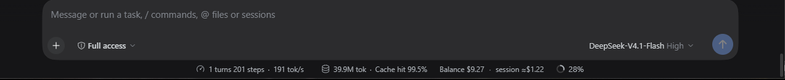

# dsh-account-odometer

A small DeepSeek Harness (DSH) **plugin bundle** that puts the account balance and this
session's estimated spend into the composer dock of the Web GUI — the row under the input
that already shows the token, cache-hit and context readings:



```
Balance $12.34   ·   session ≈$0.0186
```

Both readings are hoverable: the tooltip carries the token buckets, the rates used, and the
granted (bonus) credit when there is any.

> Кратко: плагин добавляет в строку под полем ввода «Баланс $…» и «сессия ≈$…». Баланс читается
> из аккаунта DeepSeek (тот же запрос, что делает страница Settings → Account), расход считается
> по `tokenUsage` сессии и тарифам из константы `RATES` в `lib/client.js`.

## What it shows

| Reading | Source | Notes |
|---|---|---|
| `Balance` | `account/getBalance` Remote call, identical to Settings → Account | Recharge wallets only; granted credit appears in the tooltip. Hidden while signed out or when the read fails. |
| `session ≈$…` | the durable `tokenUsage` Session projection | Whole-session log: uncached input, cache-read, cache-write and output tokens × the rates in `RATES`. Survives reloads and compaction. |

The spend figure is an **estimate**. DSH records tokens, not money, so the price comes from
the constants below. Change them to match your contract or your provider's published list.

```js
// lib/client.js
const RATES = Object.freeze({
  input: 0.28,        // USD per 1M uncached input tokens
  cacheRead: 0.028,   // USD per 1M cache-hit input tokens
  cacheWrite: 0.28,   // USD per 1M cache-write tokens
  output: 0.42,       // USD per 1M output tokens
})
```

`REFRESH_MS` (default 60 s) controls how often the balance is re-read; it is also re-read
whenever the session's token total changes, i.e. after a completed step — at most once every
`MIN_READ_GAP_MS` (20 s), so a long turn cannot flood the Platform with balance calls.

The entry sits in the same row as Chat's own readings and before the context meter:

```
1 turns 184 steps · 109 tok/s · 35.3M tok · Cache hit 99% · Balance $9.33 · session ≈$1.08 · 27%
```

## How it is built

The package is both a **bundle** (`dsh.bundle.patch` → `cordis.patch.yml`, one Loader row)
and a **client plugin** (`dsh.client.platform = "web"` → `lib/client.js`). No build step is
involved: `lib/client.js` is a hand-written bundle in the `window.__ModuleLoader__.load({
id, factory })` form that `@deepseek-ai/dsh-client-modules` serves, and it only requires
`react`, which the shell already seeds in its platform module table.

```
package.json          bundle + client declarations
cordis.patch.yml      one Loader row (id: account-odometer)
lib/index.js          host half: an empty plugin (nothing model-facing)
lib/client.js         browser half: registers one conversation.composer.dock entry
```

The entry registers with `ctx.slots.inject('conversation.composer.dock', …)` and `order: 2`,
so it lands after Chat's own `activity` (0) and `usage` (1) readings and before the context
meter. A failed read or a missing projection only hides this entry; an error boundary keeps
the rest of the composer untouched.

## Install

### Into this machine's profile

Already installed as `dsh-account-odometer` in the `desktop` profile with

```
plugin_manager install_bundle target=file:C:/Users/boas/Documents/GitHub/dsh-account-odometer
```

which runs `pnpm add` in `~/.dsh/profiles/desktop`, adds the package to
`dsh.profile.bundles`, and activates the row. A page refresh (Ctrl+R) is enough if the GUI
was already open.

### Onto another PC

Copy this folder anywhere, then either

* ask a DSH agent on that machine to run
  `plugin_manager install_bundle` with `file:<absolute path to this folder>` (or an absolute
  path), or
* do it by hand:

  ```
  dsh plugin --profile <profile> add file:<absolute path to this folder>
  ```

  then add `"dsh-account-odometer"` to `dsh.profile.bundles` in
  `~/.dsh/profiles/<profile>/package.json` and restart DSH.

If you publish the package to a registry (or push it to a Git repository), the same
`install_bundle` call accepts `dsh-account-odometer@<version>` or the repository URL instead
of the local path, and the profile records an ordinary dependency.

## Development loop

pnpm installs a `file:` directory as hard links, so after editing a source file copy it over
the profile copy and let DSH's client HMR pick up the new revision:

```powershell
$src = "C:\Users\boas\Documents\GitHub\dsh-account-odometer"
$dst = "C:\Users\boas\.dsh\profiles\desktop\node_modules\dsh-account-odometer"
foreach ($rel in @("package.json","cordis.patch.yml","lib\index.js","lib\client.js")) {
  [System.IO.File]::WriteAllBytes((Join-Path $dst $rel), [System.IO.File]::ReadAllBytes((Join-Path $src $rel)))
}
```

A failing bundle never takes the page down: DSH reports it in **Settings → Plugins → Plugin
list**, and the entry simply does not appear.

## Limitations

- **Estimate, not a bill** — price comes from `RATES`; token counts come from `tokenUsage`,
  which is the session's own durable log.
- **Own session only** — subagent child sessions keep their own logs and are not added to the
  parent's figure.
- **One rate set** — the dock does not know which model priced each step, so a session that
  switches models is priced at one rate table. Split the rates if that matters to you.
- **Owner page only** — the account Remote namespace is readable by the owner; a shared
  (LiveShare) viewer page shows the session reading only.
- **Web GUI only** — `dsh.client.platform` is `web`; the terminal/headless profiles have no
  composer dock.

## License

MIT.
